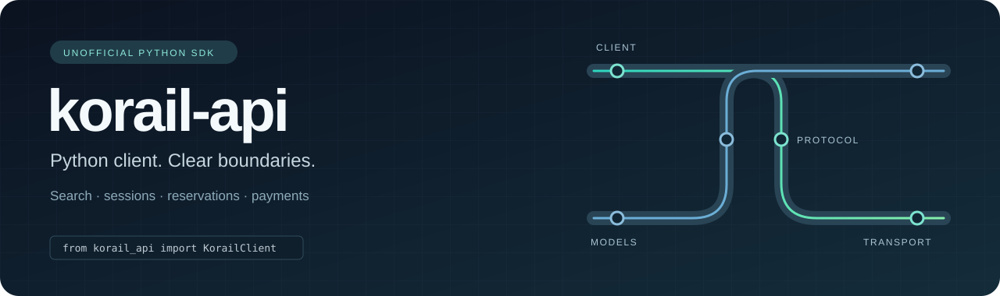

<p align="center">
  
  <br><br>
  
</p>

<p align="center"><sub>Maintainer-set status, not a live probe. Toggle with <code>python3 tools/set_api_status.py on|off</code>, then commit and push to publish.</sub></p>

# korail-api

> **Legal notice:** This is an unofficial client, unaffiliated with KORAIL. Apache-2.0 covers material the maintainer can license; it grants no service-access or trademark rights. Vendor message data has separate rights, and no independent redistribution grant has been established. Read [LEGAL.md](docs/LEGAL.md), [NOTICE](NOTICE), [third-party notices](THIRD_PARTY_NOTICES.md) and [provenance](docs/PROVENANCE.md) before use or redistribution.

[](pyproject.toml)
[](LICENSE)
[](docs/VALIDATION.md)

A synchronous Python client for the KORAIL protocol, organized around separate transport, protocol, service and model layers. Import the public client and models from `korail_api`.

**[Documentation](https://sontheo.github.io/korail-api_v2/)** · **[Architecture](docs/ARCHITECTURE.md)** · **[Validation](docs/VALIDATION.md)** · **[Contributing](CONTRIBUTING.md)** · **[Legal notice](docs/LEGAL.md)**

## What it supports

| Area | Capabilities |
| --- | --- |
| Search | Direct and transfer schedules, pagination, continuation recovery, seat maps |
| Sessions | Authentication, cookies, configuration, device profiles and explicit proxies |
| Transactions | Reservations, cancellation, payment and refund operations |
| Resources | Account and ticket reads, travel products and airport limousine operations |
| Public API | 239 root exports, 86 public client methods and typed models |

Transaction methods can affect real tickets and money. Automated validation is offline; these capabilities are not a claim of current live-service acceptance.

## Install from source

The distribution is named **`korail-api`**, version **`0.1.0`**. GitHub release `v0.1.0` includes a wheel and source archive; the package has not been uploaded to PyPI. The repository name `korail-api_v2` is separate from the Python distribution and import names.

```sh
git clone https://github.com/sontheo/korail-api_v2.git
cd korail-api_v2
python -m venv .venv
.venv/bin/python -m pip install '.[socks]'
```

## Search example

```python
from korail_api import KorailClient, TrainSearchQuery

with KorailClient() as client:
    response = client.search_trains(TrainSearchQuery("서울", "부산", "20991230", "090000"))
    for train in response.trains:
        print(train.train_no, train.departure_time)
```

Replace the example date with a valid travel date. Executing this example sends a real schedule request; automated tests do not execute it.

## Behavior that matters

- Every search obtains a fresh response; seat availability and transaction outcomes are never cached.
- Transaction requests are never retried automatically. Check uncertain outcomes through official channels before trying again.
- Decode failures retain the whole response in `error.raw`, with nested context in `error.parser_raw` when available. Treat both as potentially sensitive.
- Pagination detects repeated pages and preserves continuation metadata.
- Business rejection, malformed responses, session expiry and protocol-access rejection remain distinct.
- HTTP cookies have one owner; curl responses are adapted without a second decompression pass. Credential and payment fields are hidden from generated model representations.

## Maintenance and recovery

Explicit maintenance/rate-limit responses (including HTTP 429/503) block subsequent requests to the same configured API origin. Two consecutive transport failures also open a cooldown. Defaults are 30 minutes, 1 hour, 2 hours, then 4 hours, plus up to 10% positive jitter; a longer server `Retry-After` takes precedence. Errors expose `status_code`, `retry_after` (seconds) and `next_probe_at` (UTC Unix timestamp) when available. Invalid `strResult` values raise `KorailProtocolError` and retain `raw`.

During cooldown, login, queue admission and ordinary API calls fail locally. Once the deadline passes, only a caller-requested `get_service_status()` may probe recovery, and only one probe can run at a time. A successful status response permits ordinary calls again; it does not prove that every login or transaction endpoint is healthy. The library starts no timer, worker or background traffic. Applications should schedule one status check at `next_probe_at` only while work is pending, then resume reads gradually. Never replay an ambiguous reservation/payment automatically.

For a single-process application, use the default in-memory policy with no database configuration. Clients in that process share cooldowns and recovery-probe exclusion. Restarting the process clears this state, so the next call may contact the server again.

```python
from korail_api import KorailApiError, KorailClient

with KorailClient() as client:
    try:
        status = client.get_service_status()
    except KorailApiError as error:
        if error.next_probe_at is None:
            raise
        next_check_at = error.next_probe_at  # Schedule; do not loop immediately.
```

SQLite remains an optional advanced setting for restart persistence or multiple processes: create a `MaintenancePolicy(state_path="/app/data/korail-maintenance.sqlite3")` from `korail_api.maintenance` and pass it as `KorailClient(maintenance=policy)`. The parent directory must already exist on a local filesystem. The database stores only origins, counters, deadlines and probe leases, without credentials or response bodies; separate hosts need application-level coordination. Set `probe_lease` longer than your longest possible status request when customizing timeouts beyond the default 5-minute lease. Separate policy objects without `state_path` have independent state.

Queue transport errors no longer bypass admission to send the API request. Error retries check the remaining queue budget before sleeping or sending again, and there is no sleep after the final failure. Queue admission has a 300-second default budget; explicitly setting `KorailConfig(netfunnel_wait_limit=None)` restores unlimited normal queue waiting. The budget does not cancel an already-running HTTP request or delay token cleanup.

These are deliberate behavior corrections: `raise_on_fail=False` cannot bypass maintenance/rate-limit protection, and malformed result envelopes are rejected before later steps in a transaction. Account errors, application-update requirements and protocol-access rejections alone do not establish maintenance.

## Architecture

```text
src/
└── korail_api/
    ├── api/             Public client and convenience resources
    ├── services/        Authentication, search and transaction rules
    ├── protocol/        Request compilation and response decoding
    ├── transport/       HTTP, curl adaptation and queue admission
    ├── models/          Value objects, exceptions and type declarations
    ├── configuration/   Device and environment settings
    ├── security/        Password transformation and token serialization
    ├── messages/        Localized message lookup
    └── resources/       Protocol contracts and vendor message data
```

See [ARCHITECTURE.md](docs/ARCHITECTURE.md) for ownership boundaries and locations for behavioral changes. The package builds and runs from this repository.

## Validation and performance

The standalone suite contains **271 offline tests**. Another **1,915 synthetic decoder outcomes** are checked by the development validator. See [VALIDATION.md](docs/VALIDATION.md) for the checks and their limits.

Offline benchmarks exercise mock transports and do not establish real KORAIL request latency or acceptance.

## Development

```sh
.venv/bin/python -m pip install -e '.[dev]'
.venv/bin/python -m pytest
.venv/bin/ruff check .
.venv/bin/ruff format --check .
.venv/bin/mypy
.venv/bin/python tools/validation/check_decoder_equivalence.py
.venv/bin/python -m build
.venv/bin/python -m twine check dist/*
.venv/bin/python tools/packaging/check_artifacts.py dist/*.whl --sdist dist/*.tar.gz
```

Tests block network traffic and use synthetic data. See [CONTRIBUTING.md](CONTRIBUTING.md) for documentation builds and packaging boundaries. Do not include credentials, passenger data, payment details or unredacted responses in issues.

## License and provenance

The maintainer-authored software is offered under [Apache-2.0](LICENSE), subject to the scope and notices in [LEGAL.md](docs/LEGAL.md), [NOTICE](NOTICE) and [THIRD_PARTY_NOTICES.md](THIRD_PARTY_NOTICES.md).

Material provenance is recorded in [PROVENANCE.md](docs/PROVENANCE.md). Third-party data, runtime dependencies, trademarks and service-access permissions retain their respective rights. No live login, reservation, cancellation, payment or refund has been used to validate this release.
